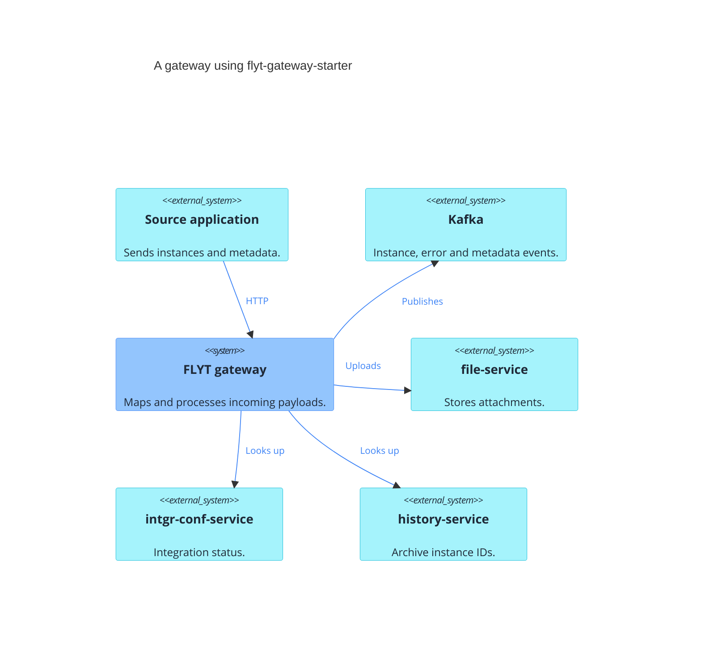
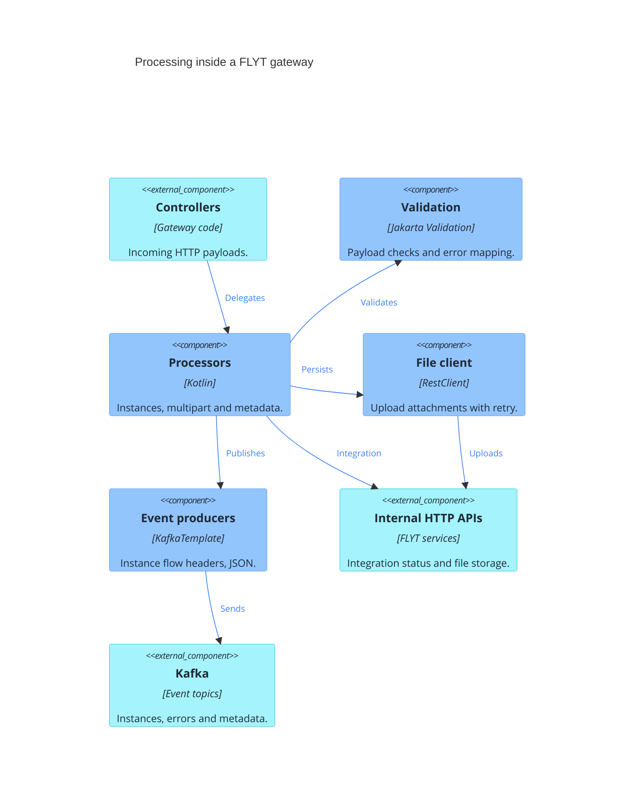

# Architecture

flyt-gateway-starter runs inside each gateway, rather than as a separate service. The context diagram shows the
embedding gateway; the component diagram shows the library inside it. Blue is the gateway or starter, turquoise is
external code and services. There is no separate container diagram because the starter has no deployment of its own.

## C4 level 1: System context

flyt-security-starter validates source application tokens against NAM and the configured client ID. The gateway uses
NAM client credentials for internal HTTP calls. Source application authorization requires no authorization-service
lookup. `HistoryClient` is available to gateway code; normal instance processing does not call it.

## C4 level 3: Components

- **Processors:** `InstanceProcessorFactoryService` creates JSON/Base64 or multipart processors with the gateway's
  mapper. They check integration status with `IntgrConfClient`, validate and map payloads, upload files and publish
  events. `IntegrationMetadataProcessor` validates and maps metadata, then publishes it. The no-ID overloads read
  `novari.flyt.security.external.source-application-id`; instance processors also accept an explicit ID.
- **HTTP clients:** `IntgrConfClient` and `HistoryClient` return `null` on 404. `FileClient` retries uploads up to five
  times with Spring Framework's `RetryTemplate`. `RestClientConfiguration` provides OAuth2 client credentials and
  timeouts, with separate registrations per target service.
- **Kafka:** producers use Boot's `KafkaTemplate`, topic names from `KafkaTopics` and the flyt-kafka header extensions.
  `KafkaConfiguration` declares the instance-error `NewTopic`. The starter registers no Kafka listeners.
- **HTTP limits and errors:** `RequestSizeLimitFilter` rejects oversized requests. Multipart and Jackson configuration
  set upload and string limits. `GlobalExceptionHandler` maps errors and preserves Spring MVC statuses such as 404/405.

## Auto-configuration

`META-INF/spring/org.springframework.boot.autoconfigure.AutoConfiguration.imports` registers the configuration classes.
`GatewayAutoConfiguration` creates the services, request size filter and exception handler with
`@ConditionalOnMissingBean`, so applications can supply replacements. Other configuration classes provide HTTP clients,
Kafka topics, Jackson limits and multipart defaults.

Services and the filter have no component stereotypes. The exception handler retains `@RestControllerAdvice` for MVC;
if an existing component scan finds it, auto-configuration backs off. Applications need no scan of the starter, and
existing broad scans remain supported. Remove a broad scan only after checking whether other dependencies still need it.

Tests cover startup without scanning through `TestApplication`, Kafka publication with an embedded broker, advice
registration with legacy scanning, and application-supplied replacements.
